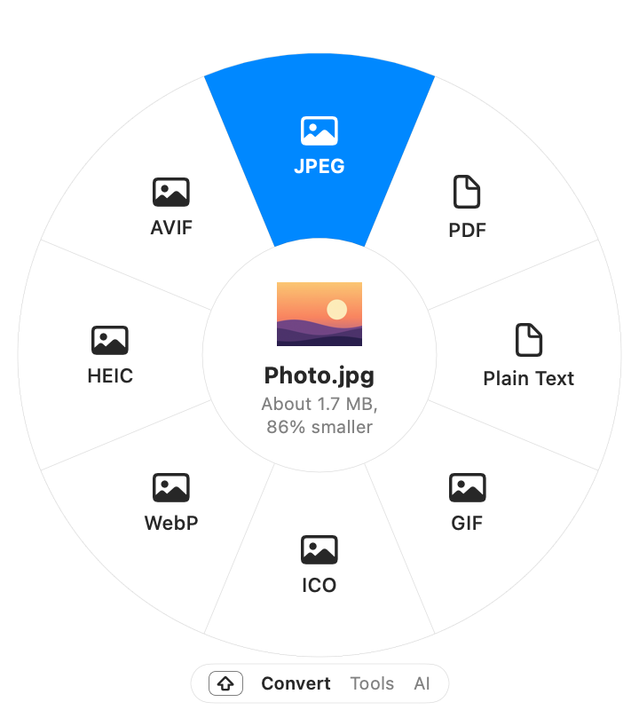
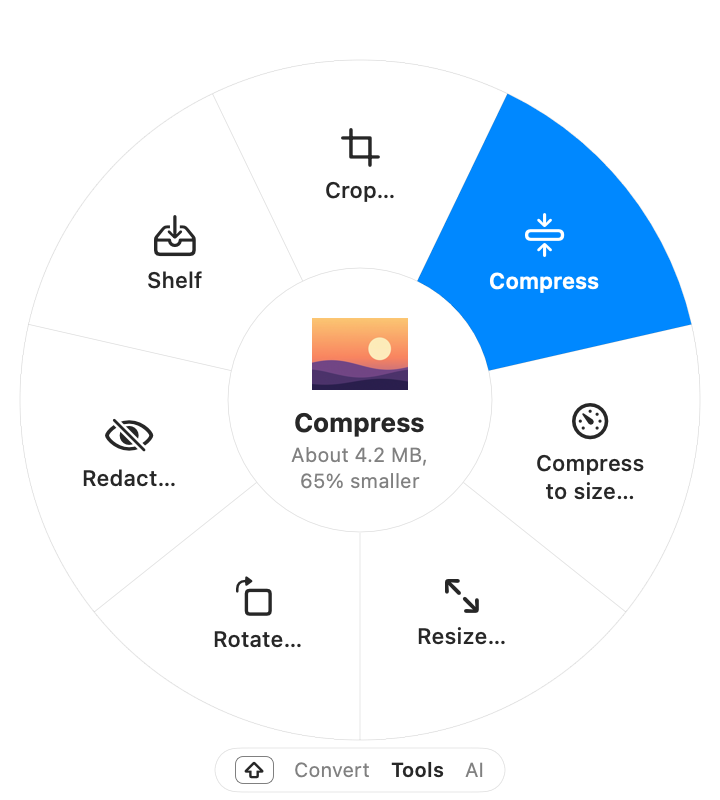
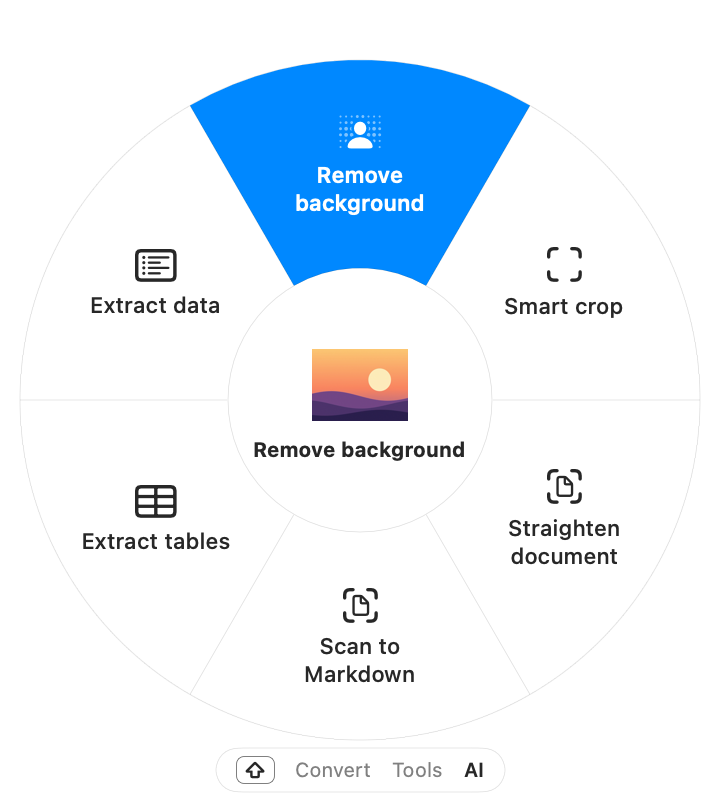
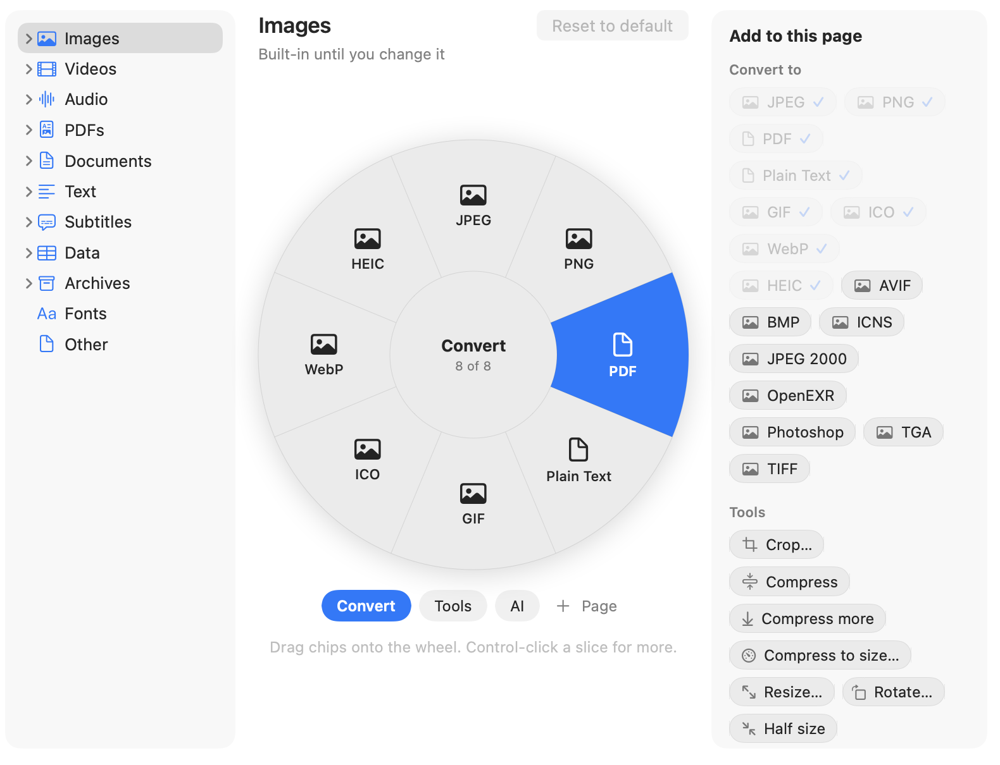
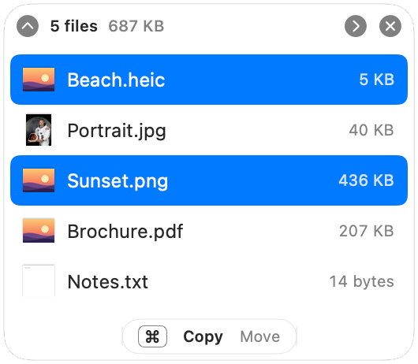

<p align="center">
  <picture>
    <source media="(prefers-color-scheme: dark)" srcset="docs/media/icon-dark.png">
    
  </picture>
</p>

<h1 align="center">Pomelo</h1>

<p align="center">
  <b>A free, open-source macOS file converter that lives at your cursor.</b><br>
  Drag files in Finder, tap ⇧, and drop them on what they should become.
</p>

<p align="center">
  <a href="LICENSE"></a>
  
  <a href="https://github.com/leopierini/pomelo/releases/latest"></a>
</p>

<p align="center">
  <picture>
    <source media="(prefers-color-scheme: dark)" srcset="docs/media/wheel-dark.png">
    
  </picture>
</p>

The new file appears next to the original, which is never touched. Everything runs on your Mac: no account, no
uploads, no telemetry, and no special permissions for the gesture.

**[Download the latest release](https://github.com/leopierini/pomelo/releases/latest)** · [Install](#install) ·
[User guide](docs/guide.md)

## Features

### Drag, tap ⇧, drop

Start dragging files in Finder and tap ⇧: a wheel opens at the cursor with everything they can become. Drop them on a
slice and the results appear next to the originals. Pomelo converts between 50+ formats (HEIC, JPEG, PNG, WebP, AVIF,
PDF, MP4, MOV, MP3, FLAC, Word, Markdown, Excel, CSV, SRT, ZIP, RAR and more), and plans a route through several
steps when there's no direct one. A long job shows its progress on the file in Finder, like a download.

### Tools, not just formats

Tap ⇧ again and the wheel flips to **Tools**: Compress, Resize, Rotate, Remove metadata, Read QR codes, Combine into
PDF, Merge and Split PDFs, Extract audio, Normalize volume, Make Zip, and more.

<p align="center">
  <picture>
    <source media="(prefers-color-scheme: dark)" srcset="docs/media/feature-tools-dark.png">
    
  </picture>
</p>

### Editors at the drop point

Some tools open a small editor right where you dropped: Trim, Split, Crop, Resize, Rotate, Organize pages, Compress
to size (pick a size, Pomelo finds the quality), and Redact, which finds faces, email addresses and text for you.

<p align="center">
  <picture>
    <source media="(prefers-color-scheme: dark)" srcset="docs/media/feature-editor-dark.png">
    
  </picture>
</p>

### On-device AI

A third page holds the tools that understand your files, all on your Mac: Remove background, Smart crop, Straighten
document and Find duplicates; on macOS 26 also Transcribe, Make subtitles, Translate, Scan to Markdown, Extract
tables and PDF to Word, and, with Apple Intelligence, Summarize and Extract data.

<p align="center">
  <picture>
    <source media="(prefers-color-scheme: dark)" srcset="docs/media/feature-ai-dark.png">
    
  </picture>
</p>

### Make the wheel yours

In **Settings › Wheel**, choose what the wheel shows for each kind of file, or for a single format, on up to four
pages you name. You edit the wheel itself: drag pieces onto it, between its pages, or off it.

<p align="center">
  <picture>
    <source media="(prefers-color-scheme: dark)" srcset="docs/media/feature-wheel-dark.png">
    
  </picture>
</p>

### The Shelf

Shake files while you drag them and they wait on the Shelf. Gather more from other folders, then drag them all out
at once, or run a tool on them right there.

<p align="center">
  <picture>
    <source media="(prefers-color-scheme: dark)" srcset="docs/media/feature-shelf-dark.png">
    
  </picture>
</p>

### No drag needed

Select files in Finder and press **⌥⌘K**, or use the *Convert with Pomelo* Quick Action. Pomelo also adds *Convert
Files* and *Run a Tool* to Shortcuts, converts whatever arrives in a watch folder, and has a `pomelo`
command-line tool with `--json` output for scripts ([build it from source](#command-line)).

The [user guide](docs/guide.md) covers every feature in detail.

## Install

1. Download `Pomelo-<version>.zip` from the [latest release](https://github.com/leopierini/pomelo/releases/latest)
   and unzip it.
2. Move **Pomelo.app** to your Applications folder.
3. Open it. Pomelo is not notarized by Apple (that needs a paid developer account), so the first time macOS refuses to
   open it. Then either:
   - open **System Settings › Privacy & Security**, scroll down to the message about Pomelo, click **Open Anyway** and
     confirm; or
   - run `xattr -dr com.apple.quarantine /Applications/Pomelo.app` in Terminal, then open it normally.

Each release lists the zip's SHA-256, so you can check your download with `shasum -a 256 Pomelo-<version>.zip`. To
update, download the new zip and replace the app: your settings and the folder access you gave are kept.

Pomelo lives in the menu bar. Its first launch shows a short welcome with one practice drag.

### Engines

Pomelo uses Apple's frameworks first. Some conversions need a free command-line engine: FFmpeg, cwebp, Pandoc and
pngquant install with one click in **Settings › Engines** (downloaded from their publishers and checked against a
SHA-256 fingerprint), and The Unarchiver (`unar`, for RAR) and LibreOffice install with Homebrew. Pomelo tells you
when a conversion needs one.

## Privacy and safety

- **Your files stay on your Mac.** The only network request Pomelo makes is downloading an engine when you click
  Install. The on-device tools use Apple's local models.
- **Originals are never modified.** Results are written to a staging folder and moved into place without ever
  overwriting a file. Anything Pomelo removes goes to the Trash. ("Replace the original", off by default, moves the
  original to the Trash once its result is in place.)
- **No Accessibility or Input Monitoring permission.** Pomelo watches only the mouse and the drag itself. The ⌥⌘K
  shortcut asks once to read Finder's selection.
- **macOS asks once per protected folder.** Because results are saved next to the originals, the first conversion in
  Downloads, Desktop, Documents, iCloud Drive or an external drive shows macOS's "access this folder" prompt. Pomelo
  only opens files you drag or select. Your answers live in System Settings › Privacy & Security › Files and Folders.

## Requirements

- macOS 14 Sonoma or later, on Apple silicon or Intel.
- Transcribe, Make subtitles, Translate, Scan to Markdown, Extract tables and PDF to Word need macOS 26. Summarize and
  Extract data also need Apple Intelligence turned on.
- Pomelo is developed and tested mostly on the latest macOS. If something breaks on an older version, please
  [open an issue](https://github.com/leopierini/pomelo/issues).

## Command line

The `pomelo` tool runs the same engines from Terminal. Build it from source (below); it ends up at
`~/Library/Caches/Pomelo-build/debug/pomelo`.

```sh
pomelo engines                              # which engines are available, and how to get the rest
pomelo targets photo.heic                   # every format a file can become
pomelo convert photo.heic --to jpg          # writes photo.jpg next to the original
pomelo convert *.png --preset half-size -o out/ --json
```

Every subcommand takes `--json`; the schema and exit codes are in [docs/cli-json.md](docs/cli-json.md).

## Build from source

You need Xcode 26.4 or later and [XcodeGen](https://github.com/yonaskolb/XcodeGen) (`brew install xcodegen`).

```sh
git clone https://github.com/leopierini/pomelo.git && cd pomelo
swift build --scratch-path ~/Library/Caches/Pomelo-build      # the core and the pomelo CLI
cd App && xcodegen generate && cd ..
xcodebuild -project App/Pomelo.xcodeproj -scheme Pomelo -configuration Release \
  -derivedDataPath ~/Library/Caches/Pomelo-build/xcode build
open ~/Library/Caches/Pomelo-build/xcode/Build/Products/Release/Pomelo.app
```

The [development guide](docs/development.md) explains the layout, the tests and the measurement harness.

## Why Pomelo?

Drag-to-convert was made popular by apps like Tangerine and [Filee](https://github.com/KnifeLemon/Filee). Pomelo is a take on the idea that is free and MIT-licensed, Mac-native
end to end, works without any special permission, and plugs into Shortcuts, Finder and the command line.

## Contributing and support

Bug reports and ideas are welcome in [Issues](https://github.com/leopierini/pomelo/issues). Read
[CONTRIBUTING.md](CONTRIBUTING.md) before opening a pull request, and [SECURITY.md](SECURITY.md) to report a
vulnerability privately.

## License

Pomelo is released under the [MIT License](LICENSE). The engines it can run keep their own licenses; see
[THIRD_PARTY_NOTICES.md](THIRD_PARTY_NOTICES.md).
